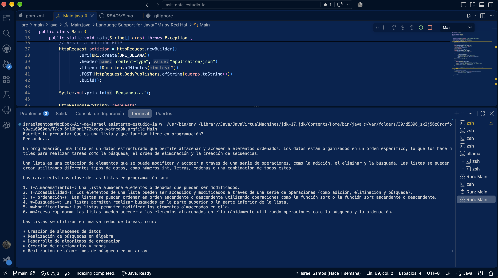
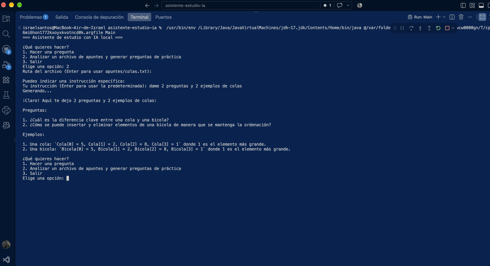

#  Asistente de Estudio con IA Local


Programa en Java con menú interactivo que permite hacer preguntas a un modelo de inteligencia artificial o generar preguntas de práctica a partir de tus propios apuntes. El modelo **corre 100 % en tu computadora**: sin internet, sin API keys y sin costo.

Proyecto personal creado para practicar Java, consumo de APIs y manejo de dependencias con Maven.

##  Demo





Ejemplo de uso:

```
Escribe tu pregunta: ¿Qué es una cola en estructuras de datos?
Pensando...

Una cola es una estructura de datos que sigue el principio FIFO
(el primero en entrar es el primero en salir)...
```

## Características

- Menú interactivo: hacer una pregunta libre o analizar un archivo de apuntes.
- Lectura de apuntes desde archivos `.txt` y generación de preguntas de práctica.
- Instrucción personalizable, por ejemplo: "Genera 10 preguntas con 3 ejemplos aplicados a ingeniería informática".
- Comunicación con la API de Ollama mediante el cliente HTTP de Java.
- Manejo de errores: avisa si Ollama no está abierto, si el modelo no existe o si el archivo no se encuentra.
- Sin claves ni datos enviados a servidores externos.

## Tecnologías

| Tecnología | Para qué se usa |
|---|---|
| Java 17 | Lenguaje principal |
| Maven | Gestión del proyecto y dependencias |
| Gson | Armar y leer JSON |
| `java.net.http` | Peticiones HTTP a la API |
| Ollama + llama3.2:1b | Modelo de IA local |

##  Requisitos

- [JDK 17 o superior](https://adoptium.net)
- [Maven](https://maven.apache.org)
- [Ollama](https://ollama.com) instalado y abierto
- Unos 2 GB libres de disco para el modelo

##  Instalación 

1. Clona el repositorio:
   ```bash
   git clone https://github.com/TU_USUARIO/asistente-estudio-ia.git
   cd asistente-estudio-ia
   ```

2. Descarga el modelo (solo la primera vez):
   ```bash
   ollama pull llama3.2:1b
   ```

3. Asegúrate de que Ollama esté corriendo (abre la app, o ejecuta `ollama serve` en otra terminal).

4. Ejecuta el programa:
   ```bash
   mvn clean compile exec:java -Dexec.mainClass=Main
   ```

5. Escribe tu pregunta y espera la respuesta. La primera vez puede tardar unos segundos mientras el modelo se carga en memoria.

## Uso

Al ejecutar el programa aparece este menú:
¿Qué quieres hacer?

1.Hacer una pregunta
2.Analizar un archivo de apuntes y generar preguntas de práctica
3.Salir


- **Opción 1:** escribe cualquier pregunta y el modelo responde.
- **Opción 2:** indica la ruta de un archivo (Enter usa `apuntes/colas.txt`) y, si quieres, una instrucción específica. Con Enter genera 5 preguntas de práctica por defecto.


## Cómo funciona

1. El programa muestra un menú y lee tu opción.
2. Si eliges analizar apuntes, lee el archivo con `Files.readString` y arma una instrucción con tus apuntes y tu petición.
3. Construye un JSON con el modelo y el mensaje usando Gson.
4. Lo envía por HTTP a `http://localhost:11434/api/chat` (servidor local de Ollama).
5. Lee el JSON de respuesta y muestra el texto generado.

asistente-estudio-ia/
├── apuntes/
│   └── colas.txt
├── docs/
│   └── captura.png
├── src/main/java/
│   └── Main.java
├── pom.xml
└── README.md

## Próximos pasos

- [x] Enviar una pregunta a un modelo local y mostrar la respuesta
- [x] Leer apuntes desde un archivo `.txt` y usarlos como contexto
- [x] Generar preguntas de práctica con instrucción personalizada
- [ ] Responder las preguntas y que el programa evalúe las respuestas
- [ ] Separar el código en clases (cliente, lector de apuntes, quiz)
- [ ] Agregar una interfaz gráfica

## Lo que aprendí

- Leer archivos de texto con `java.nio.file` y manejar excepciones.
- Diseñar prompts claros para que el modelo siga instrucciones.

##  Autor

**Israel Santos**, estudiante de Ingeniería en Informática en Instituto Tecnológico de Durango (ITD).

- LinkedIn: [Israel Santos](www.linkedin.com/in/israelsantosalvarado)
- GitHub: [IsraelSantos1445](https://www.linkedin.com/in/israelsantosalvarado)
